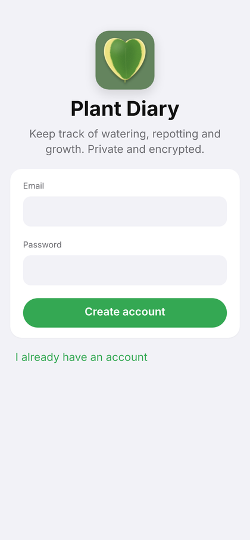
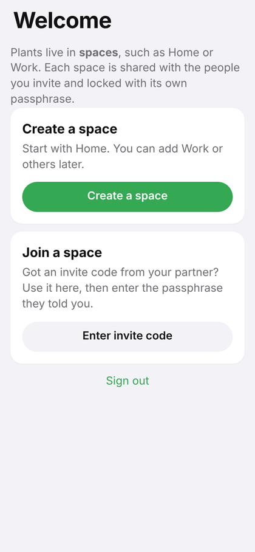
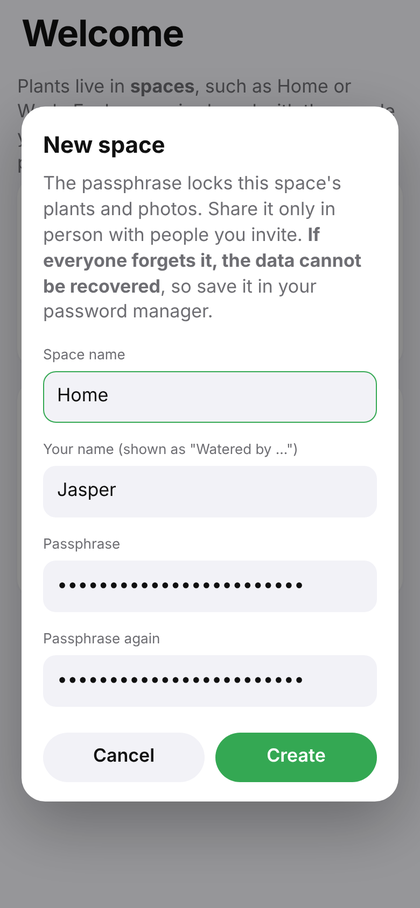
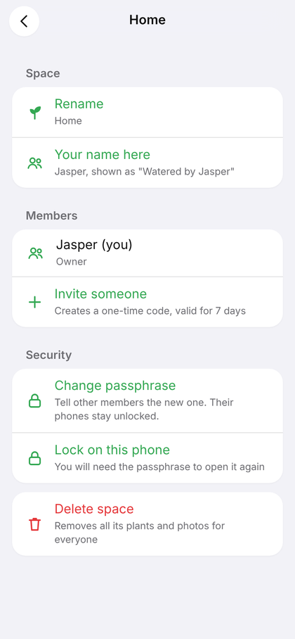
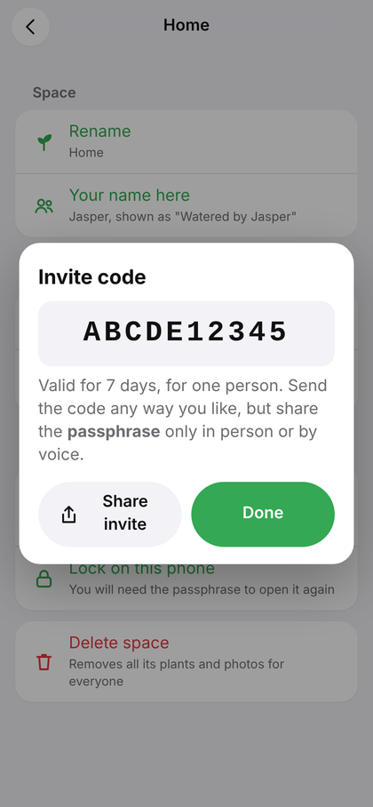
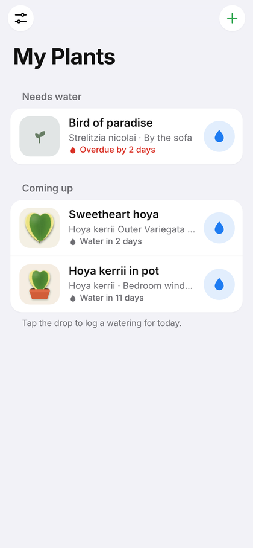
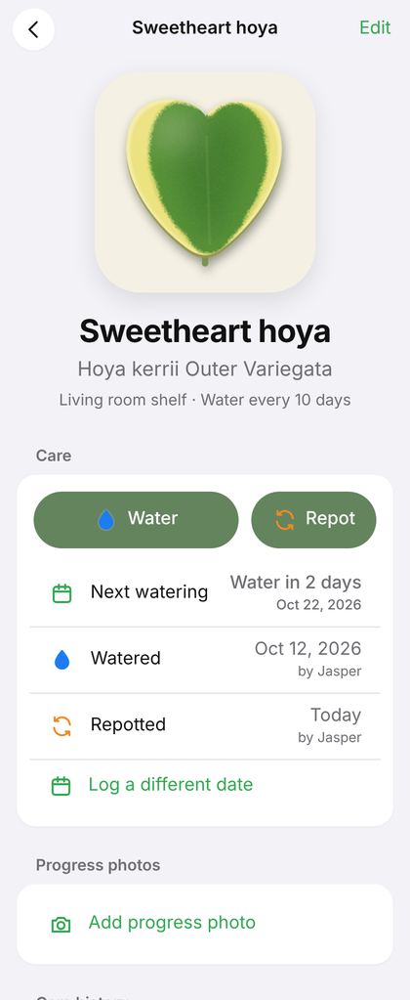
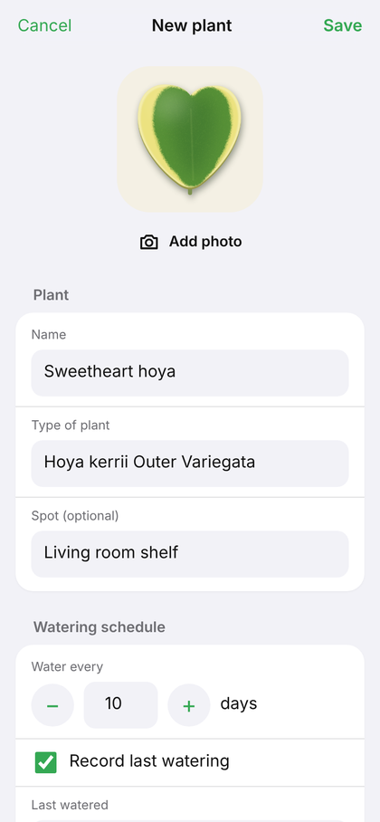
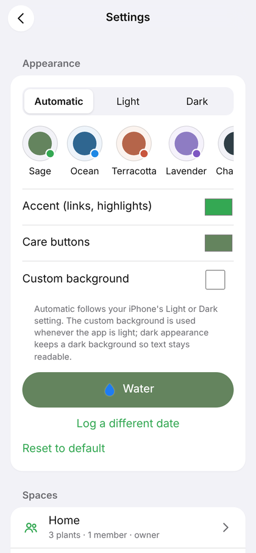
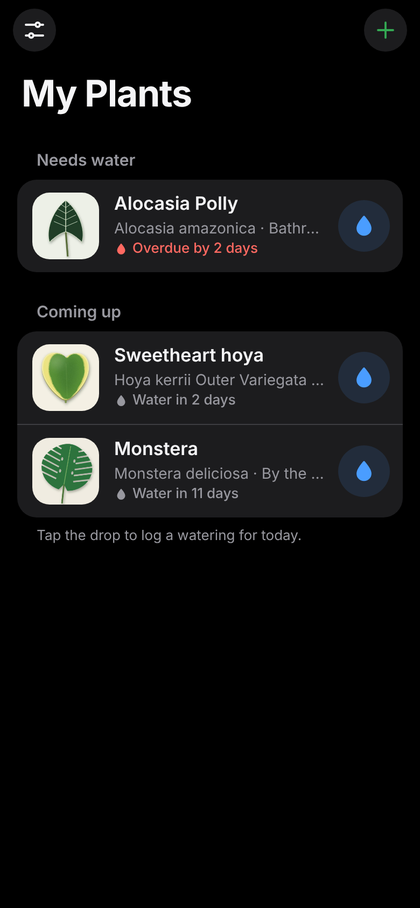

# Plant Diary setup guide

This guide takes you from nothing to a working Plant Diary on your iPhone, shared with the people you choose. Everything here is free.

| Part | Who does it | Time |
| --- | --- | --- |
| [1. One-time setup](#1-one-time-setup) | The person who owns the GitHub and Supabase accounts | 10 minutes, once |
| [2. Install on your iPhone](#2-install-on-your-iphone) | Everyone who uses the app | 3 minutes per phone |
| [3. Create your first space](#3-create-your-first-space) | The first person | 2 minutes |
| [4. Invite someone](#4-invite-someone-to-a-space) | Space owner, then the invited person | 3 minutes |
| [5. Everyday use](#5-everyday-use) | Everyone | |
| [6. Backups](#6-backups) | Anyone, every month or so | 1 minute |
| [7. Keep the database awake](#7-keep-the-database-awake) | Account owner | 5 minutes, once |
| [8. Troubleshooting](#8-troubleshooting) | | |
| [9. Updating the app](#9-updating-the-app) | Account owner | |

---

## 1. One-time setup

You need three things already in place: this GitHub repository, a free [Supabase](https://supabase.com) project, and the project's URL and **publishable** key copied into [`js/config.js`](../js/config.js). Those are done. The steps below finish the job.

### 1a. Create the database tables

1. Open your project in the [Supabase dashboard](https://supabase.com/dashboard).
2. In the left menu, click **SQL Editor**.
3. Open [`supabase/setup.sql`](../supabase/setup.sql) in this repository, click the **Copy raw file** button, and paste everything into the SQL Editor.
4. Click **Run**. You should see *Success. No rows returned*.

This creates the tables, the private photo storage, and the security rules that let each person reach only their own spaces. Running it again later is safe.

### 1b. Point the login emails at the app

1. In Supabase, click **Authentication** in the left menu, then **URL Configuration**.
2. Set **Site URL** to:
   `https://fangsheng-zhou.github.io/plant-diary/`
3. Under **Redirect URLs**, click **Add URL** and add the same address. Save.

Without this, the "confirm your email" link would point to the wrong place.

### 1c. Publish the app with GitHub Pages

1. In this repository, click **Settings**, then **Pages** in the left menu.
2. Under **Build and deployment**, set **Source** to **Deploy from a branch**.
3. Choose branch **main** and folder **/ (root)**, then click **Save**.
4. Wait a minute or two and refresh. The page shows *Your site is live at* `https://fangsheng-zhou.github.io/plant-diary/`.

> **Never** put a `service_role` or `secret` key anywhere in this repository. The publishable key in `js/config.js` is designed to be public. The database rules decide what each signed-in person can reach.

---

## 2. Install on your iPhone

Plant Diary is a web app that installs to your Home Screen. It gets its own icon, opens full screen like any other app, and works offline.

1. Open **Safari** and go to `https://fangsheng-zhou.github.io/plant-diary/`.
2. Tap the **Share** button. In newer iOS versions it may be inside the **•••** menu next to the address bar.
3. Scroll down and tap **Add to Home Screen**. If you see **Open as Web App**, leave it on. Tap **Add**.
4. Close Safari and open **Plant Diary** from your Home Screen.

> **Always use the Home Screen icon.** iPhone keeps Home Screen apps separate from Safari, so signing in inside Safari does not sign you in to the app.

### Create your account

1. In the app, tap **Create an account**, enter your email and a password (at least 8 characters), and tap **Create account**.
2. Open the confirmation email and tap the link. It may open in Safari; that's fine, it only confirms your email. The email can take a few minutes, so check your spam folder too.
3. Go back to the Plant Diary icon, tap **I already have an account**, and sign in.

---

## 3. Create your first space

Plants live in **spaces**, for example **Home** and **Work**. Each space has its own members and its own passphrase.

1. On the Welcome screen, tap **Create a space**.
2. Name it (for example **Home**) and enter your name. Your name appears in the history, as in "Watered by Jasper".
3. Choose a **passphrase** and type it twice.

### About the passphrase

- It locks everything in the space: plant names, notes, dates and photos are encrypted on your phone before upload. The database only ever holds scrambled data.
- Use at least 10 characters. Four random words work well, for example *maple teapot violet river*.
- **Save it in your password manager.** If everyone in the space forgets it, nobody can recover the data. Not the app, not Supabase, not GitHub.
- Each phone asks for it only once. After that, the phone stays unlocked until you lock it or sign out.

To add a second space later (for example **Work**, just for you), open **Settings** (the slider icon at the top left) and tap **New space**.

---

## 4. Invite someone to a space

**The owner:**

1. Open **Settings**, tap the space (for example **Home**), then **Invite someone**.
2. Tap **Share invite** to send the code by message, or read it out. The code works once and expires after 7 days.
3. Tell the other person the space **passphrase** in person or by voice. Don't send it in the same message as the code.

**The invited person:**

1. Install the app and create an account (Part 2).
2. On the Welcome screen, tap **Enter invite code** and type the code.
3. Enter the passphrase and your name, then tap **Unlock**.

Each space is separate. Someone you invite to **Home** cannot see **Work**, even technically, because they don't have its key.

---

## 5. Everyday use

- **Home screen:** plants that need water come first, with how many days are left or overdue. Tap the blue **drop** to log a watering for today. Tap **Undo** in the message at the bottom if that was a mistake.
- **Add a plant:** tap **+**. Add a photo, a name, the type of plant, where it sits, how often to water it, and care notes.

  

- **Plant page:** tap **Water** or **Repot** to log it for today, or **Log a different date** for past care. Add **progress photos** to watch it grow. Tap a history entry to remove it.
- **Spaces:** when you have more than one, use the **All / Home / Work** buttons at the top of the home screen.
- **Offline:** changes made without a connection are saved on the phone and upload automatically when you're back online.

### Appearance

In **Settings > Appearance**:

- **Automatic / Light / Dark.** Automatic follows your iPhone's setting.
- **Theme presets** (Sage, Ocean, Terracotta, Lavender, Charcoal), or pick your own colors for the accent, the care buttons and the background.

These settings are saved per phone, so everyone can choose their own look.

---

## 6. Backups

Your data lives in Supabase, but an extra copy in your own cloud storage protects you if anything ever happens to the database or the account.

**Make a backup**

1. Open **Settings** and tap **Export backup**.
2. In the share sheet, tap **Save to Files** and choose **iCloud Drive** or **Google Drive**.

The file contains every unlocked space, including photos, encrypted with each space's passphrase. A good habit is once a month, and before big changes such as deleting a space.

**Restore a backup**

1. Open **Settings** and tap **Restore from backup**, then pick the file.
2. Enter the passphrase each space had **when the backup was made**.

A restore always creates a new space, named for example *Home (restored)*, so it never overwrites anything.

---

## 7. Keep the database awake

Supabase pauses free projects after about a week without activity. Your data stays safe, but the app can't reach it until someone clicks **Resume project** in the Supabase dashboard. Normal use keeps it awake. This free daily ping covers busy weeks.

1. Create a free account at [Cloudflare](https://dash.cloudflare.com/sign-up).
2. In the dashboard, open **Workers & Pages**, click **Create**, then create a Worker from the "Hello World" starter. Name it `plant-diary-keepalive` and click **Deploy**.
3. Click **Edit code**, delete everything, paste the contents of [`keepalive/worker.js`](../keepalive/worker.js), and click **Deploy**.
4. Open the Worker's **Settings**, find **Triggers** (sometimes called **Trigger events**), and add a **Cron Trigger** with the schedule `17 9 * * *`. That runs every day at 09:17 UTC.
5. To check it: open the Worker's address in a browser. It should show `200 "ok"`.

---

## 8. Troubleshooting

| What you see | What to do |
| --- | --- |
| **"Can't reach your database"** banner | The free project may be paused. Sign in to the [Supabase dashboard](https://supabase.com/dashboard), open the project, and click **Resume project**. Nothing is lost, and changes made meanwhile upload afterwards. Then set up Part 7 so it doesn't happen again. |
| No confirmation email | Wait a few minutes and check spam. Supabase's built-in email sender is slow and limited to a few emails per hour. |
| Confirmation link opens an error page | Check Part 1b: the Site URL and Redirect URL must match the app address exactly, including the `/plant-diary/` at the end. |
| "That passphrase is not correct" | Passphrases are case-sensitive. If the owner changed it, ask for the new one. |
| A space shows as **Locked** | That phone hasn't been given the passphrase yet, or it was locked. Tap **Unlock**. |
| The app shows an old version | Close it fully and reopen it. Updates install on the next launch. |
| New Home Screen icon doesn't appear | Delete the Home Screen icon and add it again from Safari (Part 2). Your data is safe because it lives in the database. |
| Forgot your account password | Tap **Forgot password?** on the sign-in screen. This resets your login only; space passphrases are separate. |

---

## 9. Updating the app

The app updates itself: when new code is pushed to the `main` branch, each phone picks it up the next time Plant Diary is opened.

If you change the code yourself:

1. Edit the files and test them.
2. In [`sw.js`](../sw.js), increase `VERSION` (for example from `plant-diary-1.2.0` to `plant-diary-1.2.1`). This tells phones to download the new files.
3. Commit and push to `main`.

If an update changes `supabase/setup.sql`, run it again in the SQL Editor (Part 1a). It's safe to run more than once.
